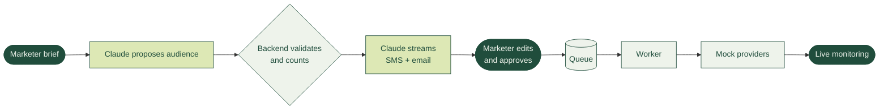
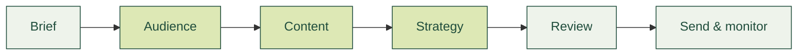
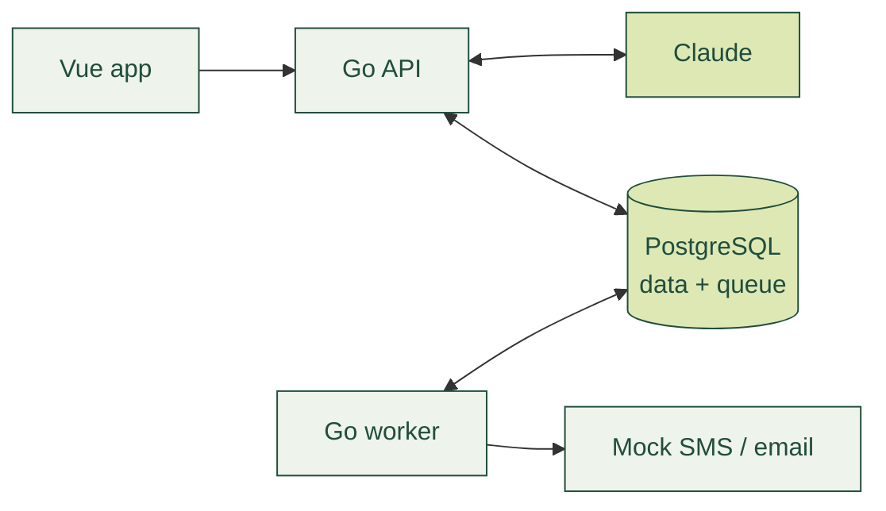
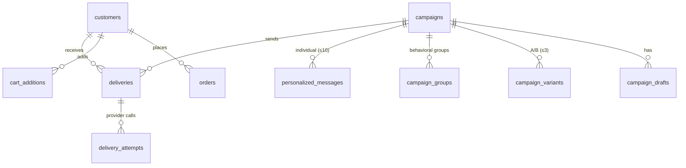

# Decisions

The marketer writes a brief, Claude proposes, the backend checks, and a person decides before anything is sent.

## Product features
- `case bonus` **A/B variants.** The marketer picks up to three drafts as variants. Each customer always gets the same one.
- `case bonus` **Content in the customer's language.** Turkish and English versions are created automatically; other languages receive English.
- `case bonus` **Scheduled sending.** A time can be set from the delivery page, and the existing worker sends the campaign through the same path.
- `extra` **Unlimited drafts.** Edit, regenerate with feedback, duplicate or write by hand. A draft is never overwritten.
- `extra` **Audience alternatives.** The exact match comes first, then labelled variations, each with counts and real customer previews.
- `extra` **Behavioral groups.** Each group gets a message with its own angle and a reason the marketer can read.
- `extra` **Individual personalization.** One AI call per customer, capped at 10 for cost.
- `extra` **AI cost transparency.** Shown as a projection before anything expensive runs.
- `extra` **Audience Explorer.** Six standard audiences, with behaviour metrics and customer insights.

## How I worked
- **Step by step.** I started with a bare foundation and a simple customer dashboard to prove the data flow, then added and reviewed one feature at a time.
- **Minimal stack.** Go `net/http` with pgx, PostgreSQL, Vue. No ORM, UI kit, router or state library.
- **Agent discipline.** `CLAUDE.md` stops the coding agent from restarting services or running full test suites for every change. Suggestions that added complexity without product value were left out.

## Product and design
- **My own design.** I created the theme, visual language and wireframes in `docs/design-docs`, then polished every flow one by one.
- **A workflow, not a chat.** A campaign is a series of decisions, and a chat would hide them.

Green steps are AI proposals; every step waits for the marketer.
- **Honest states.** Loading, generating, locked and failed states show what is really happening, with no fake progress.
- **Languages inside the message.** In review, a message's languages are switched inside it, so they don't look like extra variants.

## Audience
- **No SQL from the LLM.** Claude returns rules; the backend validates them and counts real customers.
- **Never silently change the audience.** A vague brief gets a question, an unsupported one says what's missing, and the exact match always comes first.
- **Realistic data.** Customers come from behaviour patterns, about three-quarters are Turkish, and names fit each customer's language.

## Content
- **Real streaming.** Text arrives from Claude as it is written, and a broken generation is never saved.
- **The marketer controls the copy.** Regenerating builds on the edited draft plus feedback.
- **No invented offers.** Discounts or codes that aren't in the brief are flagged, and the limits are checked by the system.

## Delivery

- **No new infrastructure.** PostgreSQL is the queue and a separate Go worker sends; every strategy uses the same pipeline.
- **A realistic mock.** Delays, 429s, server errors, lost responses and addresses that always fail. Skips come only from real consent rules.
- **Monitoring that explains failures.** Every recipient with their attempts, plus manual retry. No one gets the same message twice.

## Evaluation
- **A hand-written eval set, run against real Claude.** 45 scenarios across audience, content, localization, behavioral groups and personalization, built from real marketer situations instead of the cases the code already handles.
- **Expectations written first.** Expected behaviour is set before the first run and never changed to make a scenario pass. Results are reported as PASS / FAIL / REVIEW in `evals/hardening/reports/` and reviewed before anything is fixed.
- **Kept apart from the tests.** `make test` uses a mock LLM and needs no key; the evals run only when enabled.

## Database

- **One PostgreSQL, one schema file.** Customer data, campaigns and the send queue live together in `schema.sql`, applied on startup.
- **Duplicates stopped by the database.** A delivery is unique per campaign, customer and channel, and the approved content is frozen as a snapshot on the campaign.
- **Traces kept separately.** `segmentation_runs` and `content_runs` store every AI call; `mock_provider_messages` and `worker_heartbeats` support the mock provider and the worker.
