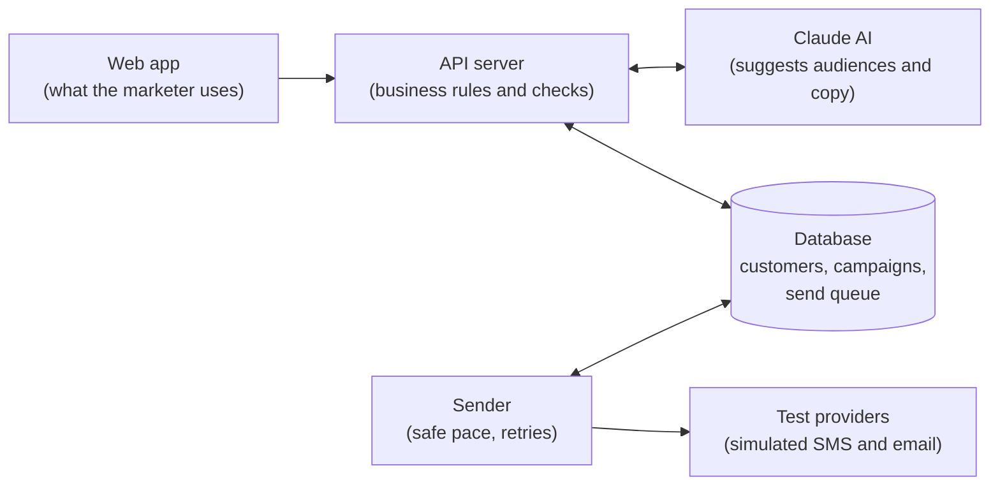

# Smart Campaign Composer: product overview

A plain-language tour of what the product does and why its results can be trusted. For setup, the API and technical
details, see the [README](README.md).

## In one paragraph

A marketer writes what they want in plain words, for example *"Send a friendly 20% discount reminder to customers in
Ankara who added something to their cart in the last 14 days but didn't buy. Keep it short."* The AI proposes who to
target and drafts the SMS and email. A person reviews, edits and approves. The system then sends the messages and
shows their progress live. Everything is safe to try: the customers are synthetic and the SMS and email providers
are simulated, so nobody real is ever contacted.

## The problem

Every campaign is four separate jobs:

| Job | What it involves |
|---|---|
| Find the people | Turn a goal into exact targeting rules |
| Write per channel | A short SMS and a full email, in each customer's language |
| Respect the rules | 160-character SMS, 80-character email subject, consent per channel |
| Send safely | At scale, without duplicates, and know what happened |

The product collapses these into one brief. The AI proposes the rest, and a person always makes the final decision.

## The five steps

1. **Describe.** Write the goal in plain words, in English or Turkish.
2. **Audience.** The AI proposes two or three audiences as readable rules (for example *"City is Ankara · added to
   cart in the last 14 days · no purchase since"*). The first option is the exact reading of the brief; the others are
   labelled variations. Each shows how many people match and how many can be reached by email and by SMS. A vague
   brief gets a question back, and anything our data can't express (such as age) is named instead of guessed.
3. **Messages.** The SMS and email appear on screen as the AI writes them. The marketer can edit them, ask for a new
   version with feedback, or write one by hand. Every version is kept as a draft.
4. **Approve.** A review screen shows who gets which version, flags problems and shows what the AI work cost.
   Approval is an explicit step, and it freezes the content.
5. **Send and watch.** Send now or schedule a time. A live page shows progress by channel, A/B variant and group.

## How personal each message gets

The marketer picks one strategy per campaign. Switching never deletes drafts.

| Strategy | What happens | Good for |
|---|---|---|
| Single message | Everyone receives the same approved draft | Simple announcements |
| A/B test | 2–3 drafts split evenly; each person always gets the same one | Comparing angles |
| Behavioral groups | The AI suggests groups (for example repeat buyers vs. first-timers) and explains why each gets its own message | Mixed audiences |
| Individual | The AI writes a message for each of up to 10 top customers; everyone else gets the base draft | VIP touches |

Language is automatic: customers receive Turkish or English versions, and anyone else receives English.

## Five promises the system keeps

These are enforced by the system itself, not left to the AI, and each one has automated tests.

- **No consent, no message.** Consent is checked when a message is queued and again right before it is sent. People
  without consent are listed as *skipped*, never silently dropped.
- **Nobody gets the same message twice.** Repeated clicks, retries or a crash can't create a duplicate.
- **What was approved is what is sent.** Content is frozen at approval; later edits to drafts don't reach customers.
- **The AI never touches customer data directly.** It proposes rules from a fixed list of fields; the system checks
  them and runs its own safe query.
- **At most 100 messages per second, per channel**, retries included, so providers are never flooded.

## How it's built



- The **web app** is what the marketer uses. The **API server** holds the business rules and runs every check.
- The **database** stores customers and campaigns, and also acts as the to-do list for sending. There is one source
  of truth, so nothing is lost when something restarts.
- The **sender** runs separately, so a slow send never slows down the screens. It sends at a safe pace and retries
  temporary errors automatically, up to 4 attempts per message.
- The **test providers** imitate real SMS and email services. On purpose, about 1 in 5 calls fails, so retries and
  failure reports can be seen in the demo.
- Without an AI key, a built-in offline stand-in replaces Claude, so the demo and the tests always run.

## How the AI is kept honest

The AI suggests, the system checks, and a person decides.

- **Fixed answer format.** The AI must answer in a strict structure. Malformed or incomplete answers are rejected and
  never stored.
- **Rule checks.** Unknown cities, products or impossible ranges are caught before anyone is counted. Messages are
  checked for length, for unsupported placeholders, and for discounts or codes that aren't in the brief.
- **Honest outcomes.** The AI can ask a clarifying question or say "we don't have that data" instead of guessing.
- **Traceable.** Every AI call is logged with its input, raw output, timing and cost.
- **Measured.** A set of 27 scenario tests run against the real AI, with expectations written before the first run.
  The latest report: 16 passed, 0 failed, 9 flagged for human review, 2 not run.

## Try it

One command starts everything, including 5,000 synthetic customers with order and cart history:

```sh
docker compose up --build
```

Then open http://localhost:5173. The [README](README.md#run) has the details.

## Known limits and next steps

| Today | Next |
|---|---|
| One sending process; running more would need a shared speed limit | Delivery receipts (opens, clicks) and an automatic A/B winner |
| Providers are simulated inside the sender | Connect a real SMS and email provider |
| "Sent" means accepted by the provider | Re-check SMS length when a scheduled send starts |
| No login or user roles | Automated build pipeline and screen tests |
